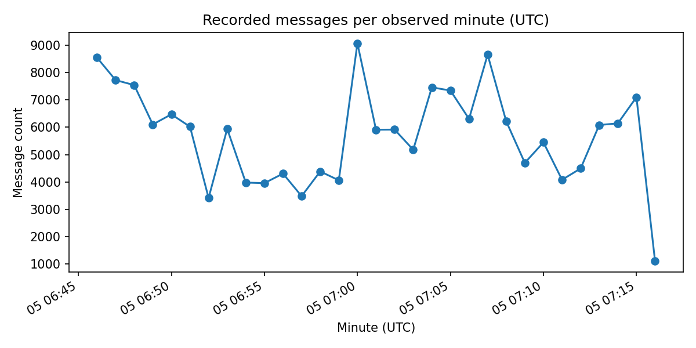
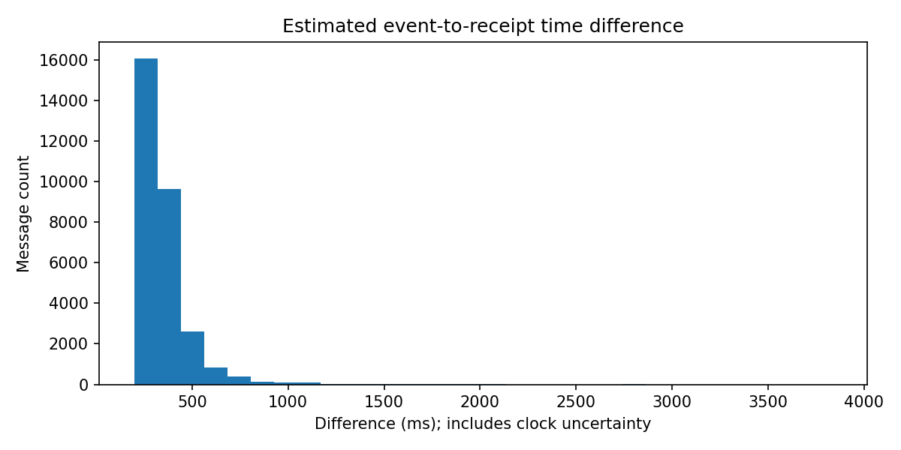

# Task 1 · BTCUSDT 现货行情采集质量报告

2026 年 11 月 5 日香港时间 14:46:13 至 15:16:13，盘口首次同步后按单调时钟录制 **1,800.001 秒**，达到 30 分钟要求。采集编号为 `整合分片_1793861166453313000`，运行正常结束。数据来自同次录制的 Parquet 日志与分类行情分片。

## 消息量与频率

全量日志统计所有已保存的实时原始消息，频率按首末消息的接收跨度 **1,802.917 秒**计算。运行窗口按程序处理消息的单调时刻划分，同步后共有 **180 个完整的 10 秒窗口**，覆盖 1,800.000 秒。两组统计按各自的范围计算。

| 消息类型 | 原始消息数 | 原始消息/秒 | 窗口内处理数 | 窗口内消息/秒 |
| --- | ---: | ---: | ---: | ---: |
| `depth` | 18,006 | 9.987 | 17,976 | 9.987 |
| `aggTrade` | 12,116 | 6.720 | 12,104 | 6.724 |
| `bookTicker` | 147,039 | 81.556 | 146,958 | 81.643 |
| 合计 | 177,161 | 98.264 | 177,038 | 98.354 |

## 连续性与一致性

| 检查 | 结果 | 核验范围 |
| --- | --- | --- |
| 盘口更新与恢复 | 应用 17,985 条，忽略 21 条，结束时待处理 0 条。盘口编号缺口、重同步和断线记录均为 0。 | 同次日志记录的原始盘口消息及其处理动作。 |
| 聚合成交编号 | 12,116 个编号连续且无重复，范围为 `4107114233` 至 `4107126348`。补回成交 0 条，估计接收时间的补回成交 0 条。 | 本次实收聚合成交的首末编号区间。 |
| 离线盘口回放 | **1,799/1,799（100%）**。 | 买卖两侧各前 20 档的价格和数量，分母为已保存的摘要。 |
| 在线快照对账 | **60/60** 次可比价位一致。差异、不可验证、丢弃和错误均为 0 次。 | 本地盘口与交易所快照在对应时点有足够证据可比较的价位。 |
| 分类行情落盘对账 | **577,078 行**匹配，缺失和额外行均为 0。 | 以同次日志重建的分类记录核对分片内容。一条盘口消息可拆为多行价位记录。 |

日志中的计划摘要遗漏记录为 0 条，相邻已保存摘要间隔为 0.940–1.056 秒。离线回放通过率衡量已保存摘要的可复现性。逐秒摘要覆盖与交易所上游消息完整性超出上述校验的范围。

## 交易所事件到本机接收的估算时差

对 `depth` 和 `aggTrade`，用本机接收时间减去估算的时钟偏差，再减去交易所事件时间 `E`。偏差取本机发出 HTTPS 请求与收到响应的时间中点减去交易所返回的服务器时间。校时样本要求 RTT ≤ 1,000 ms，最长使用 60 秒，检测到时钟跳变时停用。结果同时受交易所发布、网络传输、本机读取和校时误差影响。`bookTicker` 缺少 `E`，因此没有可用时差样本。

30/30 个校时样本满足有效性规则，HTTPS 连接均为复用。校时 RTT 中位数 437.758 ms，最大值 681.811 ms。行情处理中检测到 0 次时钟跳变。30 次校时的偏差点估计均触发 500 ms 阈值告警，按日志的 RTT 误差裕量扣减后均未超阈值。

| 消息类型 | 全量日志可用样本 | 中位数（ms） | P99（ms） | 最大值（ms） | 运行窗口可用样本 |
| --- | ---: | ---: | ---: | ---: | ---: |
| `depth` | 17,954 | 314.973 | 1,000.623 | 3,829.095 | 17,953 |
| `aggTrade` | 12,096 | 310.717 | 1,120.862 | 3,832.472 | 12,096 |
| `bookTicker` | 0 | — | — | — | 0 |

全量日志中，盘口和聚合成交消息有 30,050/30,122（99.76%）可估算时差。按 10 秒运行窗口统计，这两类消息的覆盖率为 **30,049/30,080（99.90%）**，最后五分钟为 **4,930/4,933（99.94%）**。各 10 秒窗口的时差最小值、P50、P99 和最大值可在日志的 `runtime_stats` 中查阅。

## 图表

消息按本机接收时间分入 UTC 自然分钟，首尾为部分分钟。

时差直方图合并全量日志中可估算的 30,050 条盘口和聚合成交消息。

每分钟原始消息数

| 分钟（UTC） | 消息数 |
| --- | ---: |
| 2026-11-05T06:46Z | 8546 |
| 2026-11-05T06:47Z | 7724 |
| 2026-11-05T06:48Z | 7541 |
| 2026-11-05T06:49Z | 6104 |
| 2026-11-05T06:50Z | 6474 |
| 2026-11-05T06:51Z | 6021 |
| 2026-11-05T06:52Z | 3420 |
| 2026-11-05T06:53Z | 5940 |
| 2026-11-05T06:54Z | 3980 |
| 2026-11-05T06:55Z | 3960 |
| 2026-11-05T06:56Z | 4308 |
| 2026-11-05T06:57Z | 3485 |
| 2026-11-05T06:58Z | 4387 |
| 2026-11-05T06:59Z | 4064 |
| 2026-11-05T07:00Z | 9065 |
| 2026-11-05T07:01Z | 5911 |
| 2026-11-05T07:02Z | 5915 |
| 2026-11-05T07:03Z | 5179 |
| 2026-11-05T07:04Z | 7458 |
| 2026-11-05T07:05Z | 7343 |
| 2026-11-05T07:06Z | 6306 |
| 2026-11-05T07:07Z | 8653 |
| 2026-11-05T07:08Z | 6217 |
| 2026-11-05T07:09Z | 4700 |
| 2026-11-05T07:10Z | 5449 |
| 2026-11-05T07:11Z | 4083 |
| 2026-11-05T07:12Z | 4495 |
| 2026-11-05T07:13Z | 6083 |
| 2026-11-05T07:14Z | 6143 |
| 2026-11-05T07:15Z | 7100 |
| 2026-11-05T07:16Z | 1107 |

## 磁盘占用与一天数据量估算

| Parquet 分片 | 文件大小（字节） | 文件系统分配空间（字节） |
| --- | ---: | ---: |
| 日志 | 15,938,787 | 18,886,656 |
| 分类行情 | 16,675,678 | 22,720,512 |
| 合计 | 32,614,465 | 41,607,168 |

以两类分片的合计文件大小除以本次同步后录制时长，再乘以 86,400 秒，估算 **约 1.57 GB/日**（十进制）。该外推假设消息速率与压缩后的单位存储量全天维持本次样本水平。
